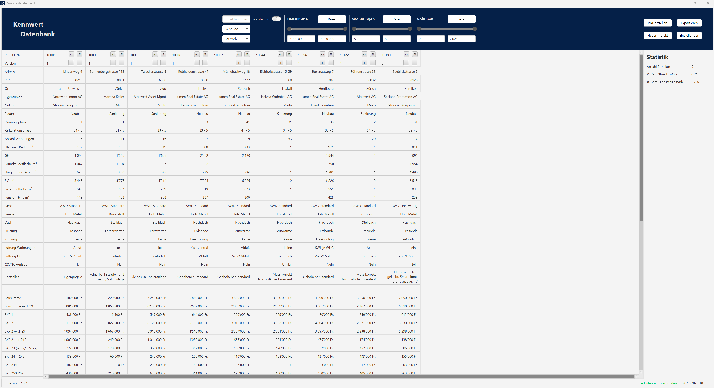
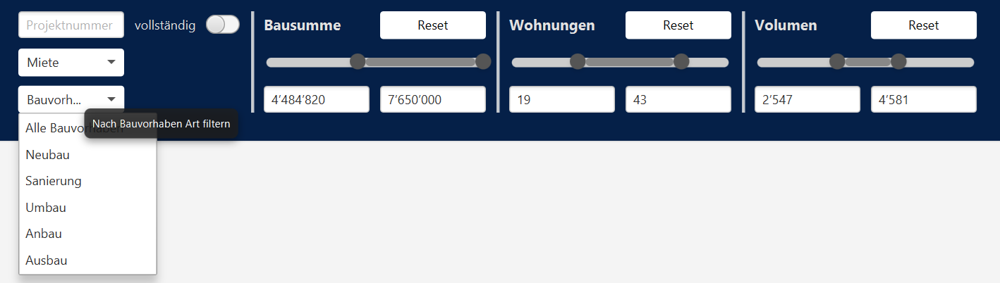
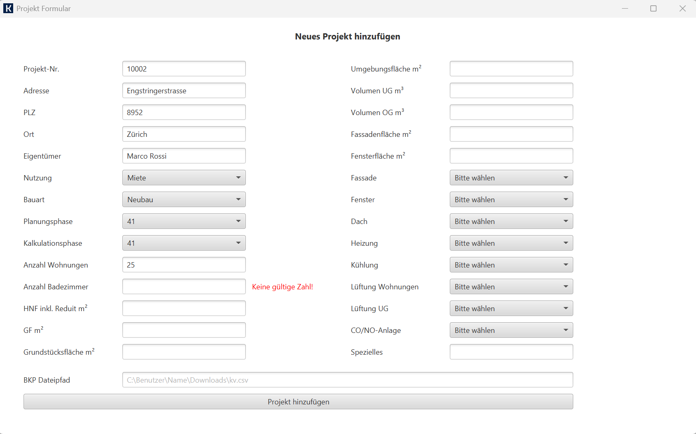

# Kennwertdatenbank

A desktop application for managing and comparing **construction cost benchmarks** (Baukostenkennwerte), built with **Java**, **JavaFX** and **PostgreSQL**.

Projects are imported from *Messerli Bauadministration* and stored in a central database. Cost planners can then filter, compare and export them side by side, replacing a manual research workflow. The application is in production use at IM Baumanagement AG.

*Screenshot with anonymized demo data.*

## Features

- **Side-by-side comparison** of projects with building data, technical systems and costs by BKP (Swiss construction cost classification)
- **Filters** by project number, usage, building type and construction type, plus range sliders for construction cost, number of apartments and volume
- **Statistics panel** with averages across the filtered projects (e.g. basement/upper-floor ratio, window-to-facade ratio)
- **Project form** with input validation and CSV import of the BKP cost breakdown
- **Versioning** of projects to track changes in the calculation
- **Export** of the comparison to PDF and Excel
- **Automatic database setup** on first start

| Filters | New project |
|:---:|:---:|
|  |  |

## Tech Stack

- Java, JavaFX
- PostgreSQL 18
- GitHub Actions: automated build of the Windows installer on each release
- Update check against the GitHub API on application startup

## Installation

1. Install a PostgreSQL 18 server.
2. Create an empty database on the server.
3. Download and run the latest installer from [Releases](../../releases).
4. Open **Settings** in the application and enter the database credentials.
5. The application creates the database schema automatically.

### ⚠️ Upgrading from version 1.x

Version 2.0 uses a new installation system and **cannot update an existing 1.x installation**.

1. Uninstall the old version.
2. Download and run the new installer.

Your data is not affected.

## Roadmap

- [x] PDF export
- [x] Excel export
- [ ] Spring Boot REST backend, so clients no longer connect to the database directly *(in progress)*
- [ ] Show differences to a selected reference project
- [ ] Additional analysis tools, e.g. cost trends and benchmarks per m²
- [ ] Web frontend or rebuild with a modern UI framework

## Author

Jonas Szedely

## License

    License Terms for Kennwertdatenbank

    Copyright (c) 2026 Jonas Szedely

    Grant of Rights
    You are hereby granted a non-exclusive, non-transferable, revocable license to use, copy, modify,
    and redistribute this software and its source code, provided that you comply with these license terms.

    No Sale, No Paid Bundling
    You may not:
    a) sell this software, any copies of it, or any modified versions of it; or
    b) include this software, any copies of it, or any modified versions of it as part of any product or
        service that is offered for a fee or other monetary or material compensation.

    Permitted Use
    You may use this software only in non-paid contexts. Internal use in organizations is allowed as long
    as the software itself, or any product or service that directly contains or depends on it, is not sold
    or otherwise monetized.

    Redistribution
    If you redistribute this software, in original or modified form, you must:
    a) include a copy of these license terms; and
    b) clearly indicate any changes you have made to the original software.

    No Warranty
    THIS SOFTWARE IS PROVIDED “AS IS”, WITHOUT WARRANTY OF ANY KIND, EXPRESS OR IMPLIED,
    INCLUDING BUT NOT LIMITED TO THE WARRANTIES OF MERCHANTABILITY, FITNESS FOR A PARTICULAR PURPOSE,
    AND NON-INFRINGEMENT. IN NO EVENT SHALL THE AUTHOR OR COPYRIGHT HOLDER BE LIABLE FOR ANY CLAIM,
    DAMAGES, OR OTHER LIABILITY, WHETHER IN AN ACTION OF CONTRACT, TORT, OR OTHERWISE, ARISING FROM,
    OUT OF, OR IN CONNECTION WITH THE SOFTWARE OR THE USE OR OTHER DEALINGS IN THE SOFTWARE.

    Governing Law
    These license terms shall be governed by and construed in accordance with the laws of the jurisdiction
    in which the copyright holder resides.
